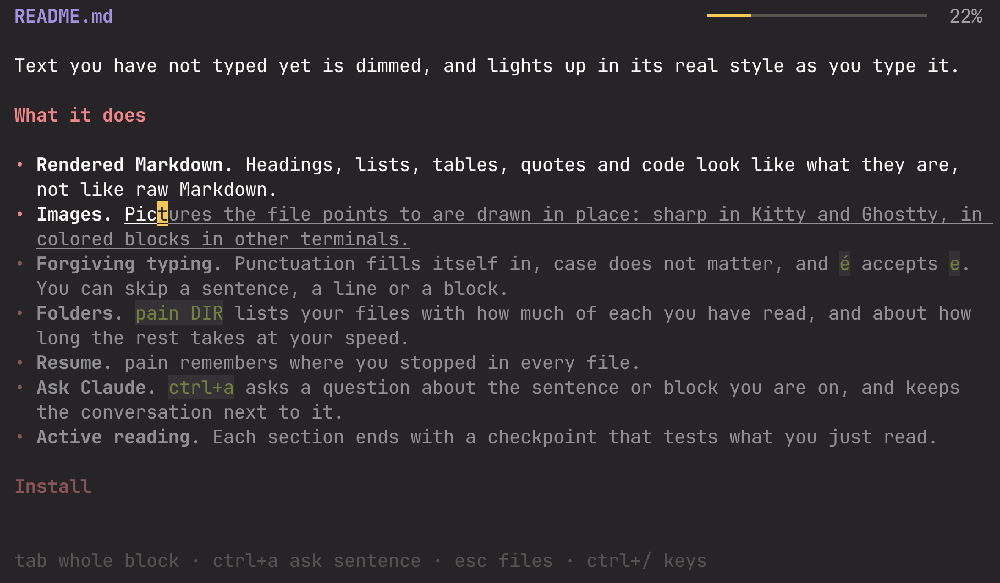

<p align="center">
  
</p>

<h1 align="center">pain</h1>

<p align="center"><b>Read Markdown by typing it.</b></p>

`pain` is a terminal app that shows a Markdown file and makes you retype it,
one block at a time, in the spirit of [monkeytype](https://monkeytype.com).
There is no timer and nothing to win. Typing keeps you active, so you take in what is
on the page instead of skimming it.

<p align="center">
  
</p>

Text you have not typed yet is dimmed, and lights up in its real style as you
type it.

## What it does

- **Rendered Markdown.** Headings, lists, tables, quotes and code look like
  what they are, not like raw Markdown.
- **Images.** Pictures the file points to are drawn in place: sharp in Kitty
  and Ghostty, in colored blocks in other terminals.
- **Forgiving typing.** Punctuation fills itself in, case does not matter, and
  `é` accepts `e`. You can skip a sentence, a line or a block.
- **Folders.** `pain DIR` lists your files with how much of each you have
  read, how its questions went, and about how long the rest takes at your
  speed. `s` shows what you typed and how fast.
- **Resume.** pain remembers where you stopped in every file.
- **Ask Claude.** `ctrl+a` asks a question about the sentence, block or
  section you are on, and keeps the conversation next to it.
- **Explain.** `ctrl+e` lets you say what you just read in your own words.
  Claude tells you whether you got it, and you can talk it over.
- **Active reading.** Each section ends with a checkpoint that tests what you
  just read.

## Install

You need Go 1.27 or later.

```sh
go install .
pain samples/tour.md    # a tour of everything pain renders
```

## Use

```sh
pain notes.md    # read one file
pain .           # browse a folder
```

| Key       | Action                                        |
|-----------|-----------------------------------------------|
| `tab`     | widen the selection: sentence, block, section |
| `ctrl+l`  | skip the selection (`ctrl+h` goes back)       |
| `ctrl+a`  | ask Claude about the selection                |
| `ctrl+e`  | explain the selection in your own words       |
| `ctrl+t`  | turn active reading on or off                 |
| `ctrl+p`  | preferences                                   |
| `ctrl+/`  | list every key                                |
| `esc`     | save your position and leave                  |

## Active reading

Press `ctrl+t` in a file, or `t` in the folder view, and pain remembers that
this folder wants more from you. From then on, each section ends with a
checkpoint. A line in the text shows where it comes, and the header counts down
the last words before it. A checkpoint is one of two kinds:

- **Questions.** Claude writes a few multiple-choice questions per section the
  first time you open a file. You answer them and see why the right choice is
  right. On the score, `r` answers them again and `ctrl+r` has new ones
  written. The score shows in the text and in the folder view.
- **Explain.** You write what the section says in your own words. Claude tells
  you whether you got it, without nitpicking, or asks a question that leads
  you to what you missed.

`ctrl+e` in the questions, or `tab` in the explanation, switches between the
two, and `esc` skips a checkpoint. A short file is one section; a longer one is
cut at its headings.

## Claude

Asking and active reading run [Claude Code](https://claude.com/claude-code),
so `claude` must be installed and logged in. They use that account, and no key
is needed. Everything else works without it.

## More

[docs/reference.md](docs/reference.md) has every key and preference, the files
pain writes, and how the code is laid out.

Built with [Bubble Tea](https://github.com/charmbracelet/bubbletea),
[Lip Gloss](https://github.com/charmbracelet/lipgloss) and
[goldmark](https://github.com/yuin/goldmark). Colors from the
[0x96f](https://github.com/filipjanevski/0x96f.nvim) theme.
