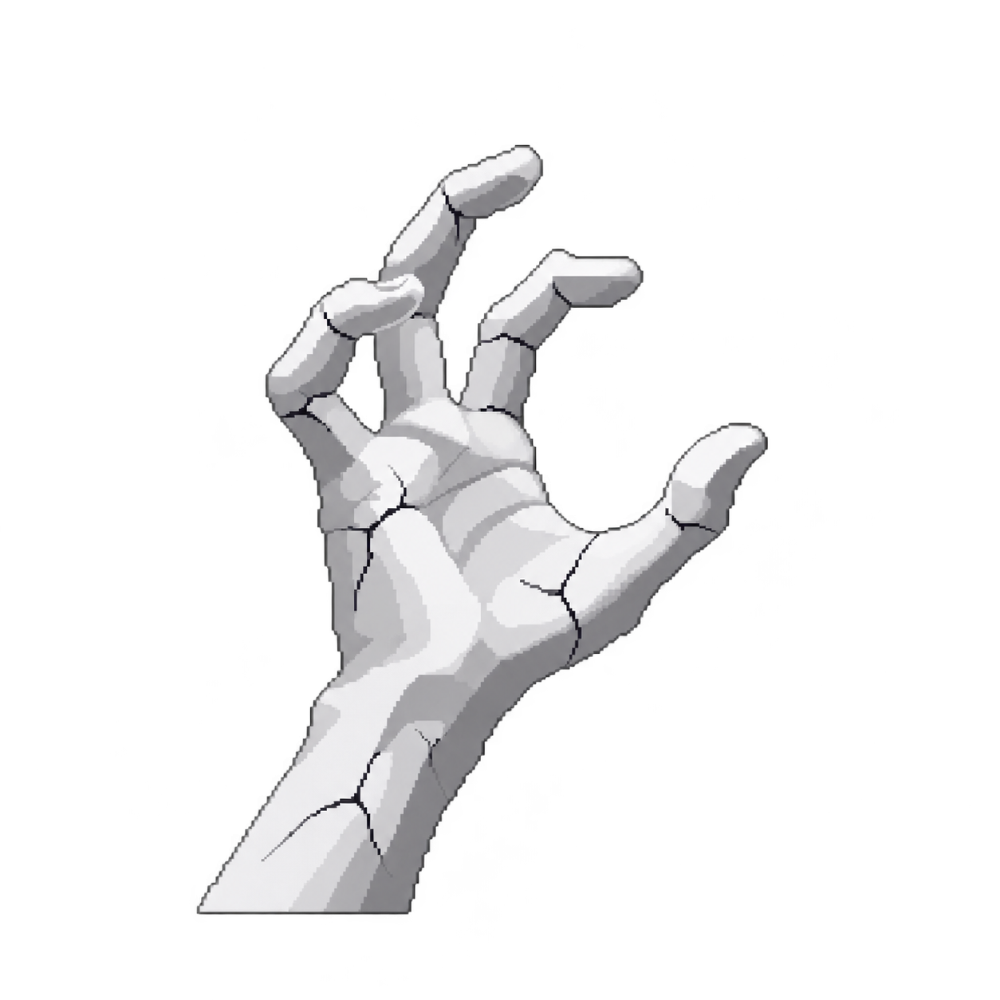

# A tour of pain

This file shows every element pain knows how to render. Type through it to see
how each one behaves. Text you have not typed yet is dimmed; text you have typed
lights up in its real colors.

## 1. Inline styles

Paragraphs can hold **bold**, *italic*, `inline code`, a [link](https://example.com)
and ~~struck~~ words. Long paragraphs wrap to the window, and you can press Enter
at the end of a line instead of the space.

Typographic characters are matched by their plain keyboard twin: “smart quotes”,
an em dash — like this one — and an ellipsis… all accept `"`, `-` and `.` as plain keys.
Accents too: café, naïve, déjà vu.

## 2. Punctuation

With *skip punctuation* on (the default), you can type straight through
brackets (like these), commas, dots... and quotes: "just type the letters".
A trailing full stop is filled in for you.

## 3. Lists

- Bullets are drawn for you
- Only the item text is typed
  - Nested items get their own bullet
- [x] Task boxes are drawn too
- [ ] And so are empty ones

1. Numbered items
2. Work the same way

## 4. Quotes

> Reading is to the mind what exercise is to the body.
> — Joseph Addison

## 5. Code

Each line of a code block is typed on its own. Leading indentation is filled in.

```go
func greet(name string) string {
	return "hello, " + name
}
```

## 6. Tables

Type a row as its cells separated by single spaces.

| Key       | Action            |
|-----------|-------------------|
| tab       | skip a block      |
| shift+tab | go back one block |
| ctrl+p    | preferences       |

## 7. Images

A picture is drawn where the file puts it. You do not type it.



---

That is the whole tour. 🎉
